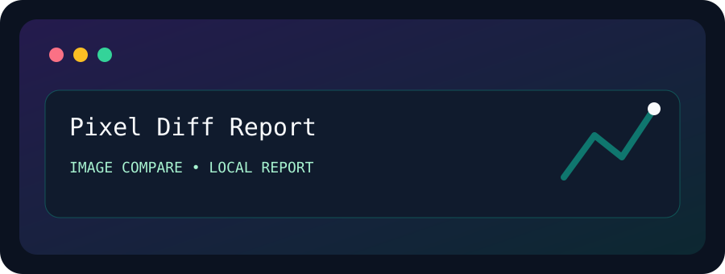

<div align="center">


[](LICENSE)
[](https://www.python.org/)
[](https://github.com/CyberLoop-dev/pixel-diff-report/stargazers)
[](https://github.com/CyberLoop-dev/pixel-diff-report/commits/main)

**A simple, local visual comparison report for two images.**



</div>

## 🧭 Overview

Pixel Diff Report compares two images of the same dimensions and writes a difference heatmap, a blended overlay, copied input images, and a self-contained HTML report. It never uploads images.

## ✨ Features

- 🖼️ Compares local PNG, JPEG, and other Pillow-supported formats.
- 🔥 Highlights changed pixels in a difference image.
- 🌓 Creates a 50/50 overlay for visual inspection.
- 📊 Reports changed-pixel ratio and mean absolute error.
- 🔒 Processes everything locally; source files are never modified.

## 🖥️ Demo

```bash
python main.py baseline.png current.png --out-dir diff-report
```
Open <code>diff-report/index.html</code> to inspect the generated comparison.

## 🚀 Quick Start

```bash
git clone https://github.com/CyberLoop-dev/pixel-diff-report.git
cd pixel-diff-report
python -m pip install -r requirements.txt
python main.py baseline.png current.png --out-dir diff-report
```

## 🧱 Tech Stack

- 🐍 Python 3.10+
- 🖼️ Pillow

## 🗂️ Folder Structure

```text
pixel-diff-report/
├── main.py
├── requirements.txt
├── tests/test_main.py
├── pyproject.toml
├── assets/illustration.svg
└── README.md
```

## 🛣️ Roadmap

- [x] Difference heatmap and overlay
- [x] HTML and JSON summaries
- [ ] Optional perceptual color-space threshold

## 🤝 Contributing

Issues and pull requests are welcome. Please include a clear reproduction or sample input and keep changes focused.

## 📄 License

Released under the [MIT License](LICENSE).

<div align="center">


</div>
